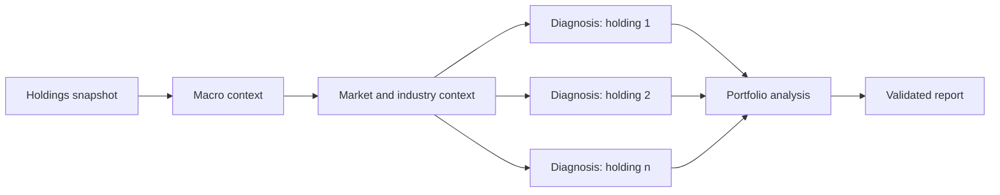

# Alpha Echo

**An AI research assistant that gives individual investors private-bank-level analysis of their holdings.**

🥇 **Winner, Finance & Wealth track** ("Democratising Private Bank-Level Advice"), Hong Kong AI Summit: BUILD ACROSS Hackathon, October 2026. 229 participants from 16 universities, 5 tracks, one winner per track.

Built over a weekend by Liu Jiaohan, Thao Nguyen, Shihan Zhang and Adam Attar.

## The problem

Private banking clients get dedicated research on every position they hold. Everyone else gets generic news and has to connect the dots alone.

## Features

- **Portfolio workbench**: log buys and sells across Hong Kong, US and Chinese A-share accounts; positions, average cost and realised P&L are computed automatically.
- **Research on every holding**: AI agents produce a structured diagnosis per position across nine dimensions: macro, industry, company, market pricing, future expectations, expectation gap, upside catalysts, downside pressure and core risks.
- **Portfolio view**: position sizing, concentration, shared risk factors and risk budget.
- **Grounded in sources**: news is collected automatically for each holding, then verified against original sources such as issuers, exchanges, regulators and recent filings.
- **Human in the loop**: the AI can draft a trade rationale, but the user must review and confirm it. The AI can never place trades or modify holdings.
- **Bilingual reports** in English or Chinese, on demand or daily.

## How it works



1. Creating a report freezes a snapshot of the portfolio and the latest news, so every report is reproducible.
2. Shared macro and market context is researched once, then one independent diagnosis runs per holding, in parallel.
3. A final stage combines the diagnoses into a portfolio-level analysis and a single report.

## Reliability by design

AI-generated financial analysis can sound convincing while being wrong, so every AI output is treated as untrusted until it passes validation:

- A Rust validator checks each output against a strict JSON schema, including evidence references, confidence levels and dates.
- Every holding must be covered exactly once: nothing missed, nothing duplicated.
- Invalid outputs never reach the report.
- If the research engine is unavailable, the report is saved as partial instead of inventing an opinion.

## Tech stack

- **Backend:** Rust (Axum, SQLx), with a background job engine that recovers interrupted tasks
- **Database:** PostgreSQL, with immutable snapshots for auditability
- **Frontend:** React and TypeScript (Vite)
- **AI research:** Codex CLI running in a read-only sandbox, with live web search for source verification

## Run it locally

Requirements: Node.js 22+, Rust 1.92+ and PostgreSQL 15+ running on `127.0.0.1:5432`.

```bash
cp .env.example .env     # then edit with your own settings
cd backend && cargo run  # API server; database migrations run automatically
```

In a second terminal:

```bash
npm install
npm run dev              # web interface
```

AI research is disabled by default. To enable it, log in to the Codex CLI and set `CODEX_RESEARCH_ENABLED=true` in `.env`.

## Tests

```bash
cd backend && cargo test
npm run typecheck
npm test
```